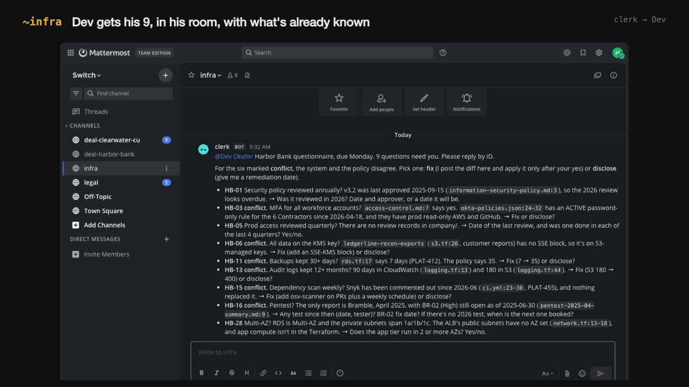
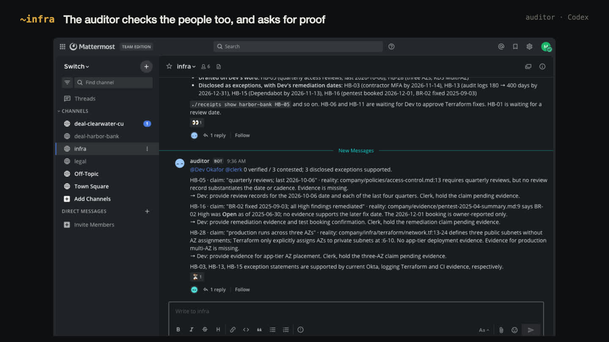
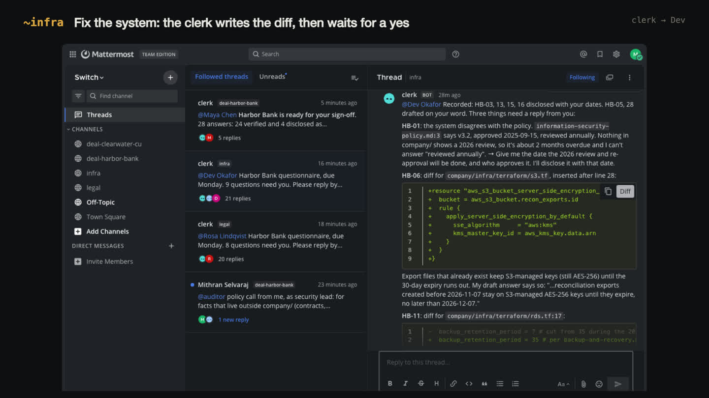
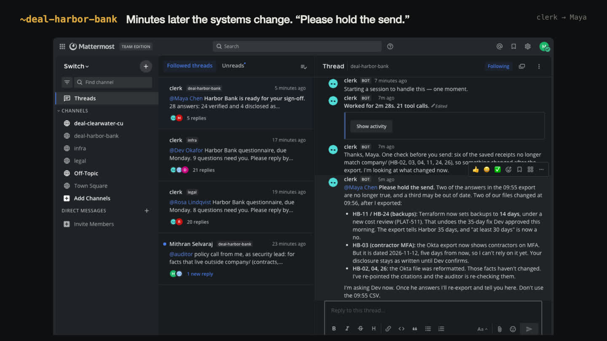

# Receipts

**A security-questionnaire desk where Claude Code, Codex and the people who own the facts work in the same Switch rooms, and nothing goes to a customer without proof.**

Built for the [Flip the Switch hackathon](https://www.wemakedevs.org/hackathons/switch), Track 01: Best Business Workflow.

> **Demo video (2:51):** https://youtu.be/gsDtqeOmh_o

---

## The problem

If you sell software to a bank, the bank sends you a security questionnaire before it signs. Thirty to three hundred questions: *Is MFA enforced for every account that can reach production? How long do you keep backups? List every subprocessor that touches our data.*

At most companies one person, usually in sales or security, fills it in by copying last year's answers and the policy documents. The answers sound right. Nobody checks them against the actual Terraform, the actual Okta config, the actual code. Then the questionnaire gets attached to the contract, and every "yes" becomes a warranty.

Systems drift and documents don't. The backup retention got cut in a cost review. Someone added a "temporary" password-only sign-on rule for contractors. A new feature started sending transaction data to an LLM API that never went through vendor review. Each of these turns last year's true answer into this year's false statement to a bank.

I expected a solo AI agent to make this worse, by repeating the stale answers faster and with confident citations. I measured it, and it doesn't. One Claude Code session with the same files ([`eval/solo_prompt.md`](eval/solo_prompt.md)) found all seven drifts and made **zero** false claims. Then it stopped, because the next step isn't reading. **22 of its 28 answers** say "we cannot confirm" or carry an `[Internal - Rosa: please confirm…]` note. Is the Terraform wrong, or the policy? Do we fix it before Monday or disclose it? Who signs the disclosure about the LLM vendor nobody reviewed? A solo agent can't answer those questions, because they belong to people. What it produced is a good gap report, and you can't send a gap report to a bank.

Finding the gaps is reading. Closing them takes the people who own the facts.

## What Receipts does

Receipts turns the questionnaire into a team workflow that runs in Switch. There are two agents on two different providers, and the people who own the facts each answer in their own room.

```
            ~deal-harbor-bank                     ~infra                        ~legal
  Maya (AE) ──► clerk (Claude Code)  ──asks──► Dev (Head of Platform)   Rosa (Legal & Privacy)
                   │   drafts every answer         ▲   │                       ▲   │
                   │   with path:line evidence     │   │ answers by ID         │   │
                   ▼                               │   ▼                       │   ▼
              auditor (Codex) ── checks every claim, the clerk's AND the people's,
                                 against Terraform, the Okta export, CI and the code
                                 and contests anything reality contradicts ─────────┘
                   │
                   ▼
   shared ledger (./receipts) ── export refuses anything not verified or honestly disclosed
```

1. **Maya** (account exec) asks `@clerk` in `~deal-harbor-bank` to take Harbor Bank's questionnaire.
2. **clerk** (Claude Code) drafts every answer from `company/`, Ledgerline's Terraform, IdP export, CI, code and policies. Every answer needs a receipt: a `path:line` that proves it. Systems beat documents, and last year's answers count as leads, not evidence. If nothing in the repo can prove an answer, the clerk doesn't guess. It looks up the owner in `OWNERS.yaml` and asks them in their room, by question ID.
3. **auditor** (Codex, a different model from the clerk, so the two don't share blind spots) checks each draft and each answer a person gives. It opens every citation, then looks for the counter-example: every bucket rather than only the cited one, every sign-on policy, every SDK the code imports.
4. When the auditor finds a contradiction, the clerk takes both sides to the owner: *you said 35 days, `rds.tf:17` says 7, which one is wrong?* There are only three ways out. The answer gets corrected. The system gets fixed: the clerk proposes the diff, and applies it only after the owner approves it in the room. Or the gap is disclosed with a remediation date. A deadline never turns into a "yes".
5. When every answer is verified or disclosed, the clerk exports the questionnaire with a receipt column and a `RECEIPTS.md`, saves what people told it so the next questionnaire asks them less, and hands it to Maya for sign-off. Agents never send anything to a customer.

## What it looks like









## Why this needs Switch

The theme is "turn your solo agent into a teammate." The difference shows up here as a number (see [Results](#results)): a solo agent can read every file, but it can't ask Dev whether the Terraform or the policy is wrong, and it can't get Rosa to own a disclosure. The work goes from plausible to true at the point where agents and the right people are in a room together. Switch is what puts them there:

| Switch piece | What it does in Receipts |
|---|---|
| **Rooms** (Mattermost channels via the Switch bridge) | One room per fact owner. Questions go where the owner already works, and the answer is recorded in that room's history as the receipt (`human:@dev in ~infra at 20:14`). |
| **Any agent, any provider** | clerk runs on Claude Code and auditor runs on Codex, both started and kept alive by Switch Console. Cross-vendor review is the point, because two copies of one model make the same mistake twice. |
| **Addressing policy** (`anyone`) | Maya, Dev and Rosa can all address the agents, not just the person who registered them. |
| **Shared working directory and context** | Both agents work from the same repo and the same ledger, so neither has to re-explain state in chat. |
| **Templates** | [`switch/receipts.template.yaml`](switch/receipts.template.yaml) creates both agents (with providers, instructions and addressing) and all three linked rooms in one import. |

Without Switch, clerk and auditor are two CLI processes that can't reach Dev or Rosa, and you're back to the solo agent.

## Results

Every number below comes from `eval/score.py`, run on the files in this repo. You can re-run each one.

**Harbor Bank (28 questions)**

| | False statements to the bank | Answers you can't send | Guesses | Dead citations |
|---|---|---|---|---|
| Last year's answers, pasted ([`eval/baselines/copy-last-year.csv`](eval/baselines/copy-last-year.csv)) | **8** of 10 | 0 | 1 | 0 |
| A solo Claude Code agent, same files ([`out/baseline/`](out/baseline/)) | 0 | **22** of 28 | 1 | 0 |
| **Receipts**: clerk + auditor + the owners, in Switch ([`out/harbor-bank/`](out/harbor-bank/)) | **0** | **0** | **0** | **0** |

What it took, from the ledger (`./receipts show harbor-bank --history`):

- **19** questions routed to their owners (9 to Dev, 8 to Rosa, plus follow-ups). **18** final answers rest on a named person's confirmation in a room.
- The auditor sent **11** answers back, each for a concrete reason: a public subnet with no AZ, a pentest finding marked Open, a draft that said "or is likely to disrupt" when Rosa hadn't said that, and Rosa's own statement that a contractor had no prod access, which the Okta export contradicted. Rosa's reply: "I was wrong."
- **5 files in `company/` were changed**, each one only after its owner said yes in the room: backups back to 35 days (`rds.tf`), the exports bucket on the KMS key (`s3.tf`), the IR plan matched to the bank MSA, Anthropic added to the subprocessor list, and the BR-02 fix recorded. The full diff is [`out/harbor-bank/company-changes.diff`](out/harbor-bank/company-changes.diff).
- 4 answers went out as honest exceptions with dates (contractor MFA, audit-log retention, dependency scanning, the overdue policy review).
- Something nobody asked: for eight months, every customer told "35 days of backups" was getting 7. The clerk raised it with Rosa as her call.

The judge is checked as well. It flags 8 of the pasted answers as false, and once the systems drifted (below) it flags the stale Harbor export too.

## How the truth is checked (the outside judge)

`company/` is a fictional 40-person fintech, Ledgerline, built to fail the way real companies do. Seven claims in its policies and last year's answers are no longer true of its systems:

| Seeded drift | Where the truth lives |
|---|---|
| Backups "retained 35 days" | `infra/terraform/rds.tf`: `backup_retention_period = 7` (a cost review in March) |
| "MFA for every workforce account" | `idp/okta-policies.json`: an ACTIVE password-only rule for Contractors, who have prod read-only and GitHub |
| "Every S3 bucket uses our KMS key" | `infra/terraform/s3.tf`: the exports bucket added in May has no SSE block, so it's on S3-managed keys |
| "Audit logs kept 12+ months" | `infra/terraform/logging.tf`: 90 days in CloudWatch, 180 days in S3 |
| "Dependencies scanned weekly" | `.github/workflows/ci.yml`: the Snyk job is commented out since June |
| "Annual pentest, all highs fixed" | `evidence/`: the only report is April 2025, with one high still open at the time |
| "No generative AI on customer data" | `services/recon/memo.py`: sends statement lines to the Anthropic API, and Anthropic isn't on the subprocessor list |

[`eval/score.py`](eval/score.py) scores any filled questionnaire (from Receipts, a solo agent, or a person) against these facts. It doesn't use an answer key. It re-derives each fact from the live files every time it runs. If Dev approves the Terraform fix and `rds.tf` now says 35, then "35 days" scores as true. The only way to a clean score is for the answer to match reality: change the answer, or change reality. It reports four numbers:

- **false attestations**: a seeded fact asserted falsely without disclosing the gap
- **dead citations**: evidence pointers that don't resolve to a real file and line
- **guesses**: questions only a person can answer (training, background checks, insurance, access reviews), answered with no person's receipt
- **not sendable**: answers still carrying an internal note, a placeholder or "we cannot confirm"

The agents are instructed never to open `eval/`. The judge is checked too: pasting last year's answers into this year's questionnaire ([`eval/baselines/copy-last-year.csv`](eval/baselines/copy-last-year.csv)) scores **8 false attestations**, so the judge does catch false claims.

## Team memory that knows when it's wrong

Anthropic's [components of agent memory](https://www.anthropic.com/research/components-of-agent-memory) (Nov 6, 2026) names the problems that matter here. Memory "can also drift and become irrelevant as the environment changes". Notes can be wrong from the start and still be "read, and trusted, by Claude in a later session". Several agents writing one shared table overwrote each other and kept 41 of 57 facts. It also asks whether continuously checking every memory is practical.

A security questionnaire is that problem with a contract attached. Last year's answers *are* team memory, and they went false without anyone noticing. So Receipts' memory stores how each fact was known, not just the fact:

- `./receipts remember <deal>` saves every final answer **with its receipts**: for a file, the cited lines and their hash; for a person, who said it, in which room, and when.
- `./receipts recall "<question>"` re-checks every receipt against the files *as they are now* before the clerk can reuse anything. **FRESH**: the evidence is unchanged, or only moved, so reuse it. **STALE**: the evidence changed, so re-derive the answer and say what changed. **EXPIRED**: a person said it over 180 days ago, so ask again. **LEAD**: last year's unreceipted answers, never evidence.
- `./receipts memcheck` re-checks the whole memory. It costs a file read and a hash per receipt: 135 receipts in 7.4 ms. Checking every memory is cheap once each memory carries its receipt, and model and people time goes only to memories that went stale.
- Memory is shared across providers. clerk (Claude Code) writes it and auditor (Codex) reads the same file, so neither depends on a vendor-specific memory feature. Writes are append-only under an exclusive lock: [`eval/memory_stress.py`](eval/memory_stress.py) runs 3 concurrent writers with 57 facts. Naive read-modify-write kept **19–24 of 57**; Receipts kept **57 of 57** in every trial.

**The live test.** Minutes after Maya signed off on Harbor Bank, [`scripts/drift.sh`](scripts/drift.sh) changed Ledgerline the way real weeks do. A new cost review cut backups to 14 days (a regression), and contractors were moved onto MFA (an improvement). Nobody told the agents.

- `memcheck` went from 28/28 fresh to **3 stale** (HB-03, HB-11, HB-24), exactly the three answers whose evidence changed. On the first try, my drift script also reformatted the whole Okta file, and HB-02/HB-04 went stale with it. Hash receipts are conservative: they'd rather re-check a reformatted line than trust a changed one.
- **The clerk caught it on its own, still in the deal room:** "Please hold the send. Two of the answers in the 09:55 export are no longer true." It also refused an Okta export with a date five days in the future, which was a bug in my drift script. The outside judge agrees: re-scored against the drifted files, the 09:55 export has 1 false attestation (HB-11 says 35 days). After Dev confirmed the change, the clerk re-exported at 10:17, and the corrected export scores 0 against the drifted systems. The timeline is in [`out/harbor-bank/STALE-EXPORT.md`](out/harbor-bank/STALE-EXPORT.md).
- **The next questionnaire** (Clearwater Credit Union, 12 questions, in different words): **9** answers reused from FRESH memory with their receipts re-checked, **2** STALE memories re-derived from the systems rather than repeated (backups now 14 days, contractor MFA now on), and **1** question for a person (credit unions aren't banks). That's **1 human ping instead of 17**, and `eval/score.py` gives it 0 false statements and 0 unsendable answers.
- Memory size: 40 memories, 135 receipts, re-checked in 7.4 ms.

## Run it yourself

You need macOS (or Windows/Linux with the Console early-access builds), Docker, Node 20+, Python 3.10+, and Claude Code and Codex CLIs signed in.

```bash
git clone https://github.com/mitzcore/receipts && cd receipts

# 1. The solo-agent baseline and its score (no Switch needed)
claude -p "$(cat eval/solo_prompt.md)" --allowedTools "Read,Glob,Grep,Write" --permission-mode acceptEdits
python3 eval/score.py out/baseline/harbor-bank-solo.csv
```

Then the Switch workflow:

1. **Install Switch Console** ([releases](https://github.com/sandbox-quantum/switch/releases/latest)), open it, and choose **Get started → On this computer → Start**. It runs a local Switch server, and Mattermost in Docker beside it. On Apple silicon, turn on Docker Desktop's *Virtualization framework* and *Rosetta*: the Mattermost image is amd64-only and crashes under QEMU.
2. **Create the people** in Mattermost. They play the owners. Use the System Console, or `mmctl` in the container:
   ```bash
   C=switchdash-local-mattermost-mattermost-1
   for u in "maya Maya Chen" "dev Dev Okafor" "rosa Rosa Lindqvist"; do set -- $u
     docker exec $C mmctl --local user create --username $1 --firstname $2 --lastname $3 --email $1@ledgerline.test --password 'pick-one'
     docker exec $C mmctl --local team users add switch $1
     docker exec $C mmctl --local token generate $1 receipts-demo   # → demo/.env
   done
   ```
3. **Create the agents** in Console (**Your Agents → Add agent**): `clerk` on **Claude Code** and `auditor` on **Codex**. Set each one's working directory to this clone and *Who can talk* to **Anyone**. Then install their instructions:
   ```bash
   scripts/switch-api.sh agent-instructions clerk   switch/instructions/clerk.md
   scripts/switch-api.sh agent-instructions auditor switch/instructions/auditor.md
   ```
   (`switch/receipts.template.yaml` describes the same two agents and the rooms as one Switch template.)
4. **Create the rooms** (four Mattermost channels with their links, members and instructions):
   ```bash
   scripts/switch-api.sh create-rooms switch/rooms.yaml
   ```
5. **Run it.** `cp demo/env.example demo/.env`, then fill in the URL and the three tokens.
   ```bash
   scripts/run-demo.sh          # resets the fixture, plays Maya/Dev/Rosa, scores the export
   scripts/drift.sh             # then: Ledgerline changes between questionnaires
   DEMO=clearwater CH_DEAL=deal-clearwater-cu python3 demo/actors.py
   python3 eval/score.py out/clearwater-cu/clearwater-cu-answers.csv
   ```
   Open Mattermost (the URL is in Console) to watch the rooms while it runs.

## What's real and what's staged

- **Real:** Switch Console 0.40.1 with a local Switch server and the bundled Mattermost; clerk is a live Claude Code session and auditor a live Codex session, both run by Switch. Nothing they say in the demo is scripted. The ledger, the export gate, the Terraform fix and the score are all real.
- **Staged:** Ledgerline and Harbor Bank are fictional. Maya, Dev and Rosa are played by [`demo/actors.py`](demo/actors.py) so the run can be reproduced without three coworkers. Each one replies only to what an agent actually asked them, by question ID, with what that person knows. The script never tells an agent what to find.
- **Typed by hand during the recorded run.** The agents asked things the script didn't anticipate: the date of the overdue policy review, proof for three of Dev's answers, and four follow-ups for Rosa. I answered those as Dev and Rosa, from the same persona facts, and then added the lines to `actors.py`. Maya nudged the clerk twice by hand ("wrap it up" once the board was done, and "is the corrected export ready?"), because agents only act when they're addressed; `actors.py` now does the first one itself. I also posted one message as the security lead: the auditor was contesting every answer that rested on a person's word (insurance, background checks, an access review in another system), so I told it in the room that a named owner's confirmation is the receipt for facts that live outside the repo. That rule is now in [`switch/instructions/auditor.md`](switch/instructions/auditor.md). Finding a gap like this in your own process is what the auditor is for. The first gap it found was in mine.

## Repo layout

```
company/                Ledgerline's source of truth (the fixture the agents read)
inbox/                  questionnaires from customers
switch/                 the Switch template and the two agents' instructions
tools/receipts.py       the shared ledger CLI (./receipts)
eval/score.py           the outside judge, plus the solo-agent prompt
demo/actors.py          the three scripted people
out/                    ledgers, exports, scores, memory snapshots, the company/ diffs
docs/                   screenshots from the recorded run
```

## What I'd do next

- **Receipts that point outside the repo.** Today a person's word is the receipt for facts in Jira, the HR system or a contract. The next step is a connector per system (Okta API, AWS Config, the contract store), so those receipts get re-checked as well.
- **Continuous drift alerts.** `memcheck` is cheap enough to run on every merge to `main`. A failing receipt would open a thread in the owner's room before the next questionnaire arrives, not after.
- **First-class "ask a person" in Switch.** Receipts builds asks out of mentions, IDs and a ledger. A Switch primitive for a structured question to a named user, with a due time the room can see, would remove most of the actor glue.
- **A bigger, adversarial benchmark.** The seven seeded drifts are mine. A fair test needs drifts written by someone else, on a real-sized estate.
